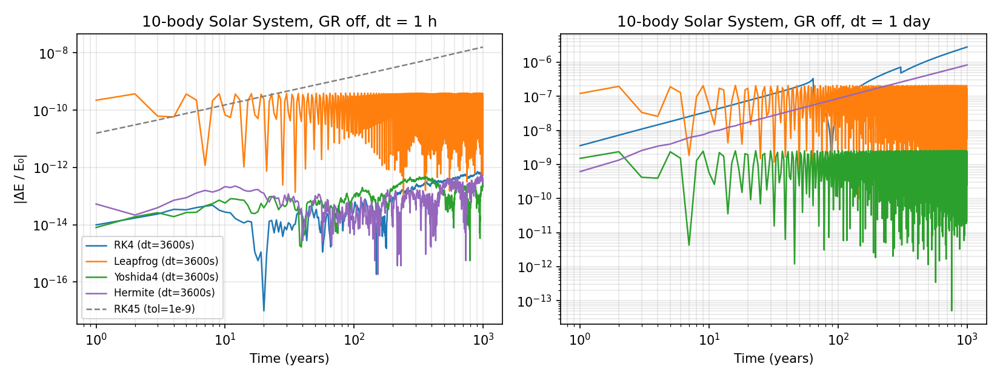

# Summary

The Orbital Mechanics Engine is a C++17 library for gravitational N-body simulation, exposed to Python through pybind11 and to the shell through a command-line interface. It provides five integrators — RK4, Leapfrog, fourth-order Yoshida, adaptive Dormand-Prince RK45, and a fourth-order Hermite predictor-corrector — and an optional Schwarzschild first post-Newtonian (1PN) correction. Initial conditions can come from NASA JPL Horizons or from DE440 via SPICE. Energy, angular momentum and linear momentum are recorded at every output step.

# Statement of Need

Established tools such as REBOUND [@rein2012rebound] are mature but hide integration details behind large code bases. For students and researchers who want a small, readable implementation in which every integration step, error estimate and relativistic correction can be inspected, we provide Python ergonomics, a 1PN perturbation and Horizons connectivity in a self-contained C++ core (no SPICE library is needed at runtime). The same simulation can be rerun with each integrator by changing one argument, which makes the numerical behaviour of the methods directly comparable.

# Functionality

## Numerical Integrators

Integrators are selected with `--integrator` (CLI) or `integrator=` (Python):

- **RK4** — classical fourth-order Runge-Kutta, four force evaluations per step.
- **Leapfrog** — second-order symplectic Störmer-Verlet, one force evaluation per step.
- **Yoshida4** — fourth-order symplectic triple composition of Leapfrog substeps [@yoshida1990].
- **RK45** — adaptive Dormand-Prince [@dormand1980] with an embedded fourth-order error estimate and user-set $\Delta t_\text{min}$, $\Delta t_\text{max}$. With the First Same As Last property an accepted step costs six new force evaluations.
- **Hermite** — fourth-order predictor-corrector using the analytic acceleration and its time derivative (jerk) [@makino1992hermite]. It is not symplectic, and it does not use the Ahmad-Cohen neighbour scheme discussed in that reference. The GR term is included in the acceleration but not in the jerk.

## Post-Newtonian GR Correction

An optional acceleration term is added after the Newtonian pairwise sum:

$$\Delta\mathbf{a}_i = \frac{GM}{c^2 r^3}\left[\left(\frac{4GM}{r} - v^2\right)\mathbf{r} + 4(\mathbf{r}\cdot\mathbf{v})\,\mathbf{v}\right]$$

where $\mathbf{r}$ and $\mathbf{v}$ are relative to the most massive body. It is off by default (`--gr` or `gr=True`). In a 100-year two-body Sun–Mercury run (RK4, $\Delta t = 1$ h) the difference in apsidal rate between GR-on and GR-off runs is 42.986 arcsec/century, against 42.981 predicted by $6\pi GM/(c^2 a (1-e^2))$ per orbit.

## Initial Conditions and Validation

`orbit-sim fetch` and `build-system` retrieve state vectors from the Horizons API [@horizons]. These differ from DE440 [@naif] at the epoch by 342–3,038 km depending on the body (Earth 2,096 km), so for validation `python/spice_ic.py` builds a system directly from DE440, with masses $GM/G$ for the engine's $G$. Starting from it and integrating the 10-body Solar System for one Julian year, Earth's heliocentric position differs from DE440 by 61 km without the 1PN term and by 0.2 km with it (RK4, $\Delta t = 1$ h). Mercury, Venus and Mars agree to 0.5 km or better with the term enabled (RK4, Hermite, RK45). The Moon remains 12 km off, which we have not explained. Leapfrog at $\Delta t = 1$ h is worse for Mercury (4,432 km); this error falls roughly as $\Delta t^2$ and is numerical.

## Other Features

Relative energy, angular-momentum and momentum drifts are exported to a CSV with the trajectory. When a Sun–Earth–Moon system is present, eclipse geometry (umbra, penumbra, type) is written to a second CSV. The C++ core returns a `SimulationResult`; `orbit.simulate()` and `orbit.simulate_adaptive()` return the same data with NumPy accessors.

# Performance and long-term conservation

All numbers come from `benchmark_rebound.py` and `python/long_run_energy_drift.py` (10-body Solar System, Newtonian, initial conditions in `systems/solar_system.json`). Timing is the median of 10 repetitions for one Julian year at $\Delta t = 1$ h; the interquartile range is at most 2.6 ms.

| Method | Median time (ms) | Relative energy drift after 1 yr |
|---|---|---|
| RK4 | 100.6 | 9.0e-15 |
| Leapfrog | 28.0 | 2.2e-10 |
| Yoshida4 | 61.7 | 8.4e-15 |
| Hermite | 90.2 | 5.3e-14 |
| RK45, tol 1e-9 | 12.1 | 1.6e-11 |
| RK45, tol 1e-12 | 47.1 | 2.2e-14 |
| REBOUND IAS15 | 43.3 | 5.6e-16 |
| REBOUND WHFast, 1 h | 84.3 | 2.6e-13 |

These timings are not matched for accuracy, and IAS15 reaches the lowest drift; we make no claim of outperforming REBOUND. A one-year run also flatters non-symplectic methods, so we repeated the study for up to 1000 years. The table gives the maximum relative energy drift $\Delta E/E_0$ (absolute value) up to the stated time.

| Method | 1 h: 10 yr | 1 h: 1000 yr | 1 day: 10 yr | 1 day: 1000 yr |
|---|---|---|---|---|
| RK4 | 4.8e-14 | 7.1e-13 | 3.7e-8 | 2.8e-6 |
| Leapfrog | 3.7e-10 | 3.9e-10 | 2.1e-7 | 2.1e-7 |
| Yoshida4 | 7.2e-14 | 4.7e-13 | 2.5e-9 | 2.6e-9 |
| Hermite | 1.6e-13 | 6.1e-13 | 8.7e-9 | 8.3e-7 |
| RK45, tol 1e-9 | 1.4e-10 | 1.6e-8 | — | — |

At $\Delta t = 1$ h, RK4 stays below Leapfrog even after 1000 years, and RK45 drifts secularly. At $\Delta t = 1$ day, RK4 and Hermite drift secularly, while Leapfrog and Yoshida4 stay bounded, Yoshida4 about 80 times lower than Leapfrog.

# AI usage disclosure

This project was developed with AI assistance (Claude, Anthropic) for implementation details, debugging, and architecture discussions. All physics decisions, architectural choices, scientific validation, and the paper's Statement of Need are the author's own work.

# Acknowledgements

Initial conditions were obtained from the NASA JPL Horizons system. SPICE validation used kernels provided by the NASA Navigation and Ancillary Information Facility (NAIF).

# References
